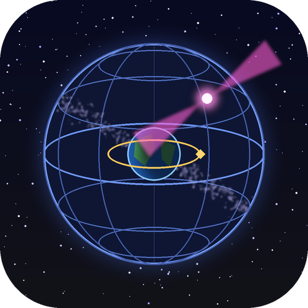

<p align="center"></p>

# Einstein@Home Sky

*A richer Einstein@Home screensaver: a 3D celestial sphere with real pulsars and gravitational waves* — original Italian name: «Cielo di Einstein@Home»

A rotating 3D celestial sphere with the Earth at the centre, turned as it is right now and lit by today's Sun, with the gravitational-wave and radio observatories (LIGO, Virgo, KAGRA, GEO600, Arecibo, Parkes) and the Fermi satellite. On the sky: stars to magnitude 5.8, constellations, the Milky Way, ~3,700 radio pulsars from ATNF (millisecond pulsars, gamma-ray pulsars seen by Fermi, magnetars), unidentified Fermi sources, supernova remnants, bright quasars and the 90 % sky areas of the gravitational-wave events.

## Features

* Click any object for a card with data and an explanation; pulsars can be **listened to** at their real rate
* *From inside* planetarium view and full-screen screensaver mode (key S)
* Data prepared once by `dati_cielo.py` and kept locally; works offline afterwards
* Not affiliated with the Einstein@Home project — it is a personal companion app

> **Language note.** The interface is in **Italian** (large, adjustable text); plots, PDF/PNG cards and scientific output are in **English**. Code comments are in Italian. The original Italian guide is [`LEGGIMI.txt`](LEGGIMI.txt).

**Version:** 1.1 (2026-11-17). **Status:** Stable: 1.1 built and tested.

## Quick start

Requirements: Python 3.10+ (tested with Python 3.14 on Ubuntu) with `tkinter` (Ubuntu: `sudo apt install python3-tk`).

```bash
git clone https://github.com/EDOKILLER/einstein-at-home-sky.git
cd einstein-at-home-sky
python3 -m pip install -r requirements.txt

python3 cielo_einstein.py --autotest
python3 cielo_einstein.py --salvaschermo
python3 cielo_einstein.py        # opens the window
```

### Standalone executable

`bash crea_eseguibile_ubuntu.sh` builds a single-file executable with PyInstaller in a temporary virtual environment, runs the self-test, and adds the program with its icon to the application menu and the desktop (first time on GNOME: right-click → *Allow launching*). On Windows 11 install Python from python.org (tick *Add python.exe to PATH*) and double-click `crea_eseguibile_windows.bat`.

The build scripts were written for the author's machine: check the paths at the top before running them.

## Data sources and acknowledgements

Data are downloaded at run time from public services. If you publish results, please follow their acknowledgement policies:

* [ATNF Pulsar Catalogue](https://www.atnf.csiro.au/research/pulsar/psrcat/)
* [Fermi Science Support Center](https://fermi.gsfc.nasa.gov/ssc/)
* [Gravitational Wave Open Science Center (LIGO, Virgo, KAGRA)](https://gwosc.org/)
* [Gravitational-wave candidate event database](https://gracedb.ligo.org/)
* [VizieR catalogue service, CDS, Strasbourg (the Harvard mirror is used)](https://vizier.cds.unistra.fr/)

This project is independent and not endorsed by any of these institutions.

## License

Code: [BSD 3-Clause](LICENSE) © 2026 Edoardo Battistel. You can use, modify and redistribute it, also commercially, as long as you keep the copyright notice; the author's name may not be used to promote derived works without permission. If you use it in research, see [`CITATION.cff`](CITATION.cff).

---
Part of a series of astronomy programs by Edoardo Battistel — see also [X-rays from Black Holes](https://github.com/EDOKILLER/x-rays-from-black-holes) and the other repositories on [this profile](https://github.com/EDOKILLER?tab=repositories).
